<div align="center">

# sd-phone

<a href="https://www.youtube.com/watch?v=Hn3WNeOE3Qc">
  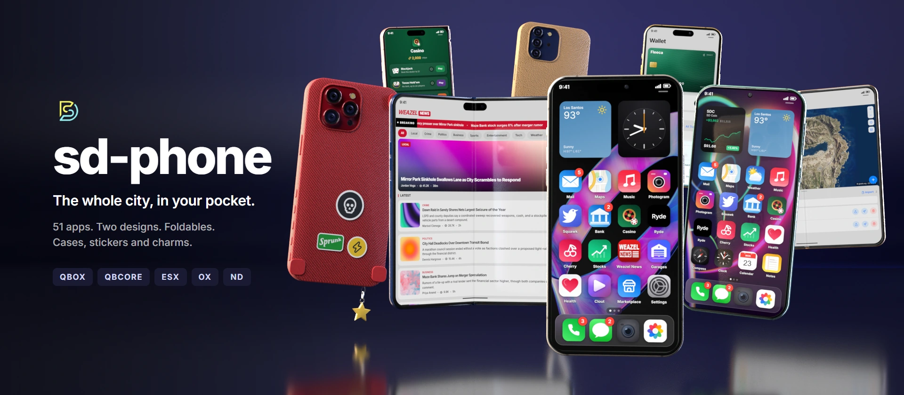
</a>

[](https://www.youtube.com/watch?v=Hn3WNeOE3Qc)
[](https://fivem.samueldev.shop/phone)
[](https://github.com/Samuels-Development/sd-phone-props)

### Preview video

<a href="https://www.youtube.com/watch?v=Hn3WNeOE3Qc">
  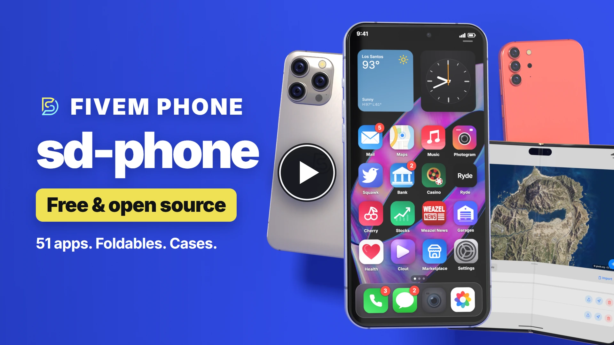
</a>

A two-minute tour of the phone: 51 apps, both designs, the foldables and the cases you design yourself.

<sub>[Watch on YouTube](https://www.youtube.com/watch?v=Hn3WNeOE3Qc)</sub>

### Browser demo

The phone and tablet UIs run in your browser with sample data. Unlock the phone, move apps around, install apps, open the police terminal or use fullscreen. Nothing to install.

<sub>[fivem.samueldev.shop/phone](https://fivem.samueldev.shop/phone)</sub>

---

sd-phone is a FiveM phone for QBOX, QBCORE, ESX, ox_core and ND. It includes calls, messages, mail, maps, banking, photos, social apps and games. Apps use server data and their own accounts where needed. The camera shows the game world. Phone props come in eight colours and match the on-screen frame. Unique phones and SIM cards are optional; each phone item can keep its own number and data.

Scripts and custom apps written for lb-phone, qs-smartphone, gksphone, roadphone or YSeries can keep using their old exports and events. For lb-phone and YSeries, the import can bring over numbers, chats, photos, wallet history, social logins and more.

[](https://github.com/Samuels-Development/sd-phone)
[](https://github.com/Samuels-Development/sd-phone/releases)
[](https://github.com/Samuels-Development/sd-phone)
[](https://discord.gg/FzPehMQaBQ)
[](https://docs.samueldev.shop/resources/phone/)


[**Live demo**](https://fivem.samueldev.shop/phone) · [**Documentation**](https://docs.samueldev.shop/resources/phone/) · [**Store**](https://fivem.samueldev.shop) · [**Discord**](https://discord.gg/FzPehMQaBQ)

**Required:** [**sd-phone-props**](https://github.com/Samuels-Development/sd-phone-props), the phones, foldables and cases you hold in game · [**ox_lib**](https://github.com/CommunityOx/ox_lib) · [**oxmysql**](https://github.com/CommunityOx/oxmysql)

**Works together:** **sd-phone** · [**sd-tablet**](https://github.com/Samuels-Development/sd-tablet) · [**sd-computers**](https://github.com/Samuels-Development/sd-computers)

</div>

---

## In game

Use it full-screen, or switch on DUI mode and the live UI runs on the phone in your character's hand, tapped with the mouse.

<p align="center"><a href="docs/previews/07-in-game.webp">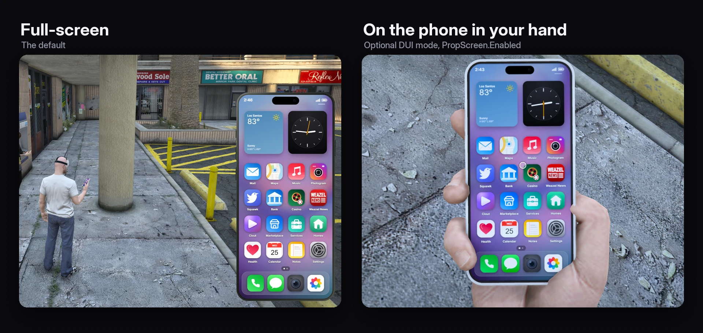</a></p>

<p align="center"><sub>Left: the default full-screen phone. Right: the optional <a href="#dui-phone-option-ui-on-the-held-prop">DUI mode</a>.</sub></p>

## Support Me

If you're enjoying sd-phone and want to support my work, consider picking up a script from [Samuel's Development](https://fivem.samueldev.shop). Every purchase helps me keep building and improving resources like sd-phone. Browse Petty Crimes, Advanced Crafting, Horde, Smash Down, and more to find something for your server.

<p align="center">
  <a href="https://fivem.samueldev.shop">
    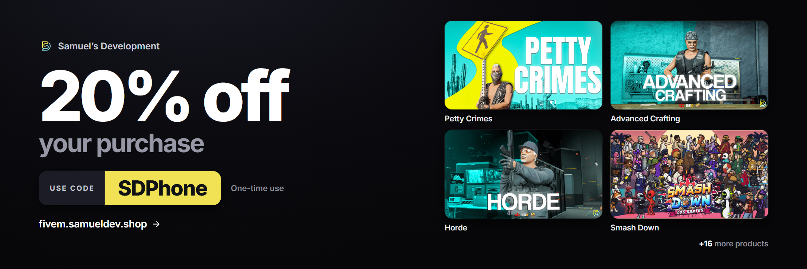
  </a>
</p>

Use code **`SDPhone`** for **20% off your purchase** at [fivem.samueldev.shop](https://fivem.samueldev.shop). **One-time use.**

## Screenshots

Captured from the browser demo using sample data. Click an image for the full 1920×1080 version.

<p align="center"><a href="docs/previews/01-home-messages.webp">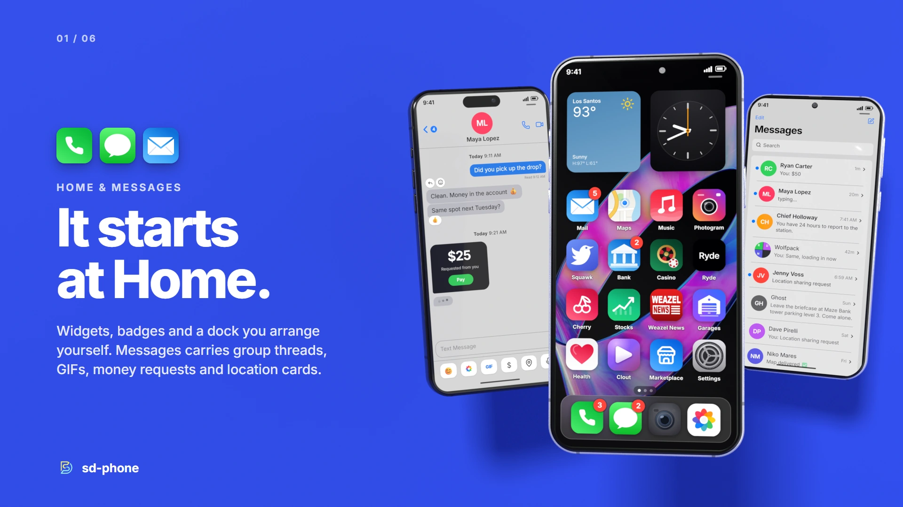</a></p>

<p align="center"><a href="docs/previews/02-social-apps.webp">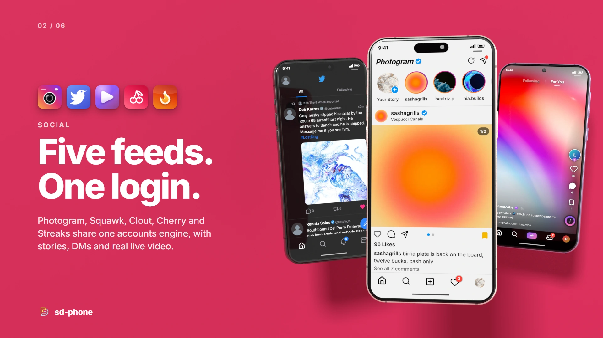</a></p>

<p align="center"><a href="docs/previews/03-maps-ryde.webp">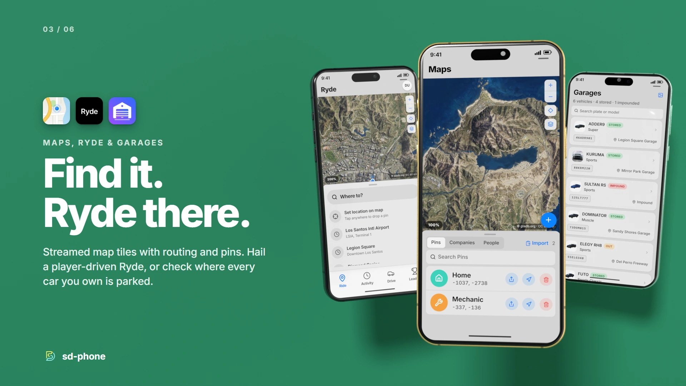</a></p>

<p align="center"><a href="docs/previews/04-banking-marketplace.webp">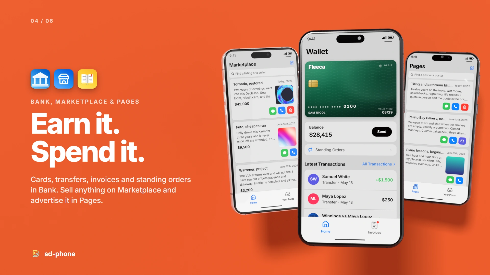</a></p>

<p align="center"><a href="docs/previews/05-weather-health-services.webp">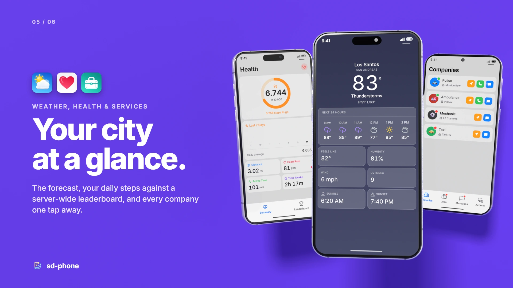</a></p>

<p align="center"><a href="docs/previews/06-fold-maps.webp">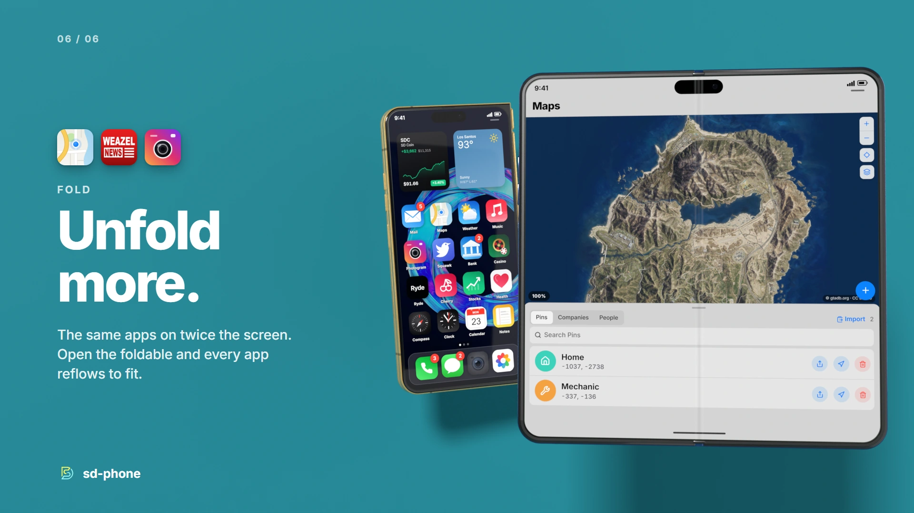</a></p>

---

> [!IMPORTANT]
> **Coming from lb-phone or YSeries? Bring your players' data across.**
> Nothing imports by itself: open **`/phoneadmin` → Migration** to preview what your old database holds, pick what to bring over and watch it run. Numbers, contacts, messages, mail, photos, wallet history and social accounts come across, so players open the phone already signed in. It never overwrites anything and is safe to re-run. Using unique phones? Turn them on **before** you import. [Migration guide](https://docs.samueldev.shop/resources/phone/installation#migrating-from-lb-phone)

> [!TIP]
> **Want a tablet? [sd-tablet](https://github.com/Samuels-Development/sd-tablet) runs these same apps on a bigger screen.**
> Same messages, contacts, accounts and wallet, because both devices read one set of player data. No pairing and no sync.

> [!TIP]
> **Got computers? [sd-computers](https://github.com/Samuels-Development/sd-computers) puts this phone on every desk in the city.**
> A free desktop for any computer prop. With both running, the phone's mail, texts, notes, contacts and gallery are on the desktop, and Weazel News, the Marketplace and the city's other apps are live websites in its browser. Needs sd-phone v1.0.7 or newer. [More below](#works-with-sd-computers).

## Powered by Fivemanage

<div align="center">

<a href="https://refer.fivemanage.com/samuel"></a>

<sub>Photos, videos and voice notes upload to <b><a href="https://refer.fivemanage.com/samuel">Fivemanage</a></b>. A free <b>Media</b> token in <code>configs/server/apikeys.lua</code> is all it needs.</sub>

</div>

## Apps

<p align="center"><a href="docs/previews/sd-phone-apps.webp">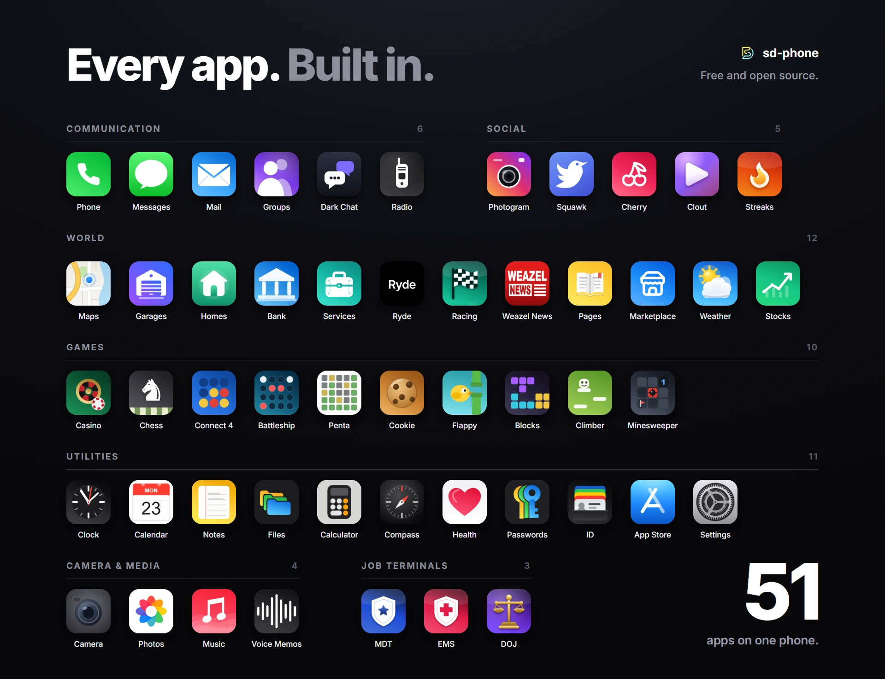</a></p>

| | |
|---|---|
| **Communication** | Phone (1:1, group and company calls over pma-voice), Messages (SMS, group threads, GIFs, money and location cards), Mail (multi-account, global inboxes), Groups, Dark Chat, Radio, Find Friends |
| **Social** | Photogram (posts, stories, DMs, real live video streaming), Squawk, Cherry, Clout (short-form video), Streaks, all on a shared accounts engine with registration, sign-in, and password resets delivered in-game |
| **Camera & media** | Camera (live game view: photos, video with voice capture, selfie mode), Photos, Music (with AirShare library sharing), Voice Memos |
| **World** | Maps (CDN-streamed tiles, routing, pins), Garages, Homes, Bank, Services (company directory, dispatch messaging, phone multijob), Ryde (player-to-player ride hailing), Racing (race board with an in-game track creator, unlocked by a `racing_usb` item), Weazel News, Pages, Marketplace, Weather, Stocks |
| **Games** | Casino (Slots, Roulette, Blackjack, Baccarat, Crash and Texas Hold'em on a shared chip balance), Chess, Connect Four, Battleship and Wordle with online lobbies, plus Cookie, Flappy, Blocks and Climber with server-side leaderboards |
| **Job terminals** | MDT, EMS and DOJ, job-gated, with records, warrants, reports, a firearms registry, live CCTV, and bodycam and dashcam review. Off by default: set `Enabled = true` in `configs/mdt.lua`. Best on the bigger screen of [sd-tablet](https://github.com/Samuels-Development/sd-tablet) |
| **Utilities** | Clock (alarms), Calendar, Notes (with sketches), Files (documents with multi-signer signing, sendable as mail attachments), Calculator, Compass, Health (daily stats and a server-wide steps leaderboard), Passwords, ID (identity cards from your character record and licences, showable to a nearby phone), App Store, Settings |

**Home screen widgets:** eleven of them, each in three sizes and placed anywhere: Weather, Clock, Digital Clock, Now Playing, Wallet, Stocks, Contacts, Garage, Activity, Weazel News and Timers & Alarms. Most come in Dark, Light or Glass, which frosts your wallpaper behind the tile.

## Highlights

- **Real accounts.** Social apps have registration, sign-in and password resets delivered by in-game mail or SMS, and accounts work across characters.
- **A live camera.** The Camera shows the game world in real time, clips record your microphone and nearby voices, and Photogram Live streams real video to other phones.
- **Plugged into your server.** Garages and Homes work with 14 garage and 13 housing systems, Wallet reads your framework's bank, and Services turns jobs into companies players can call and message.
- **Custom apps.** One export turns any web page into an installable app, and apps built for lb-phone run unmodified. Start from the [app templates](https://github.com/Samuels-Development/sd-phone-app-templates) and the [custom app guide](https://docs.samueldev.shop/resources/phone/custom-apps).
- **Drop-in compatible.** Scripts written for lb-phone, qs-smartphone, gksphone, roadphone or YSeries keep working: their exports are answered and their events mirrored. [Details](https://docs.samueldev.shop/resources/phone/lb-phone-compatibility)

**For developers:** [server exports](https://docs.samueldev.shop/resources/phone/exports-server), [client exports](https://docs.samueldev.shop/resources/phone/exports-client), [events](https://docs.samueldev.shop/resources/phone/events-server), [custom apps](https://docs.samueldev.shop/resources/phone/custom-apps) and [lb-phone compatibility](https://docs.samueldev.shop/resources/phone/lb-phone-compatibility) are all documented.

## Works with sd-computers

<div align="center">

<a href="https://github.com/Samuels-Development/sd-computers"></a>

[](https://github.com/Samuels-Development/sd-computers)
[](https://fivem.samueldev.shop/computer)

</div>

With both running, a computer becomes another screen for the character's phone: its mail, Messages, Notes, Contacts, gallery and documents, and the city's public apps (Weazel News, the Marketplace, Pages, Squawk, the company directory, the penal code and the stock market) as live websites. Everything goes through the phone's own actions, so it is checked and rate limited exactly as on the phone. Nothing to set up: the link ships with sd-phone **v1.0.7 and newer**, and `set sd_phone_computerlink "off"` switches it off.

## Compatibility

| Layer | Supported |
|---|---|
| Frameworks | QBCore, QBox, ESX, ox_core, ND (auto-detected) |
| Inventories | ox_inventory, one_inventory, tgiann-inventory, qb-inventory, qs-inventory(-pro), origen_inventory, codem-inventory, jaksam_inventory, lj-inventory, ps-inventory |
| Voice | pma-voice |
| Housing | 13 housing systems for the Homes app |
| Garages | 14 garage systems for the Garages app, plus ND_Core as the fallback on ND |
| Notify | ox_lib (default), lation_ui (opt-in), framework-native fallback |

## Installation

> [!IMPORTANT]
> Download **`sd-phone.zip`** from the [latest release](https://github.com/Samuels-Development/sd-phone/releases/latest), not the green **Code** button: that is the source, with no built UI, and the phone opens blank.

It needs [ox_lib](https://github.com/CommunityOx/ox_lib) (v3.39.0 or newer), [oxmysql](https://github.com/CommunityOx/oxmysql) and [sd-phone-props](https://github.com/Samuels-Development/sd-phone-props). Start them first:

```cfg
ensure ox_lib
ensure oxmysql
ensure sd-phone-props
ensure sd-phone
```

The database tables create themselves. Then add the phone items (one per colour in `configs/phone.lua`, `phone_black` onwards), your Fivemanage key and, for video calls between different networks, a TURN relay. All of it, step by step: **[installation docs](https://docs.samueldev.shop/resources/phone/installation)**.

### Building from source

Cloned the repo? Build the UI, which lands in the gitignored `web/build/`:

```bash
cd web
npm ci
npm run build
```

### Phone cases

Players dress their phone in a case that everyone sees on the phone in their hand. A case is a shell in one of seven styles and 64 colours, with an optional pattern, back accessory, swinging charm and sticker (an icon, a brand, or one of the player's own gallery photos). The models come from [sd-phone-props](https://github.com/Samuels-Development/sd-phone-props).

- **Case stores:** cases are designed and bought at stores in the world (`Stores` in `configs/cases.lua`: a clerk, a blip, a price list). Talking to the clerk stands the player's own phone in a studio booth in front of a camera in 3D: drag to turn it, scroll to zoom, and it wears whatever the customizer beside it has picked. With no target resource (ox_target, qb-target, qtarget) the store opens with E.
- **A case is an item:** buying one puts a `phone_case` item in the player's pockets with the design stored on it. It can be given, traded, sold or handed out by other scripts like anything else.
- **A case belongs to a phone:** using the item fits the case to the player's phone, asking which when they carry several, and the case that phone had comes back as an item. It is kept on that phone's own item, so each phone has its own case and it goes wherever the phone goes. At a store, "Put it on now" fits the phone on show.
- **The phone itself:** the store's Phone tab holds the free choices about the phone: its design (classic or Slate), the logo on its back and coloured trims. `Looks.Designs` in `configs/phone.lua` says which designs a server has: both, or only one.
- **Taking it off:** the phone item's Phone Case button (or `/phonecase`), or Settings, Phone Case, on the phone itself: the case comes back as an item.

Add the item to your inventory. For ox_inventory, in `data/items.lua`:

```lua
['phone_case'] = {
    label = 'Phone Case',
    weight = 40,
    stack = false,   -- every case carries its own design
    close = true,
    consume = 0,     -- required: sd-phone takes the item itself when the case goes on
    description = 'A phone case. Use it to put it on your phone.',
    server = { export = 'sd-phone.usePhone_case' },
    buttons = {
        { label = 'Put On a Phone', action = function(slot) exports['sd-phone']:fitPhoneCase(slot) end },
    },
},
```

and give each phone item a button for its own case, next to any it already has:

```lua
buttons = {
    { label = 'Phone Case', action = function(slot) exports['sd-phone']:openPhoneCaseMenu(slot) end },
},
```

Right-clicking a case then offers "Put On a Phone" (a list when the player carries several), and right-clicking a phone offers "Phone Case": take off the one it has, or fit one from the pockets. Inventories with no buttons on their items get the same list from the `/phonecase` command (`Command` in `configs/cases.lua`).

For qb-core and Qbox items (`shared/items.lua`):

```lua
phone_case = { name = 'phone_case', label = 'Phone Case', weight = 40, type = 'item', image = 'phone_case.png', unique = true, useable = true, shouldClose = true, description = 'A phone case. Use it to put it on your phone.' },
```

The icon is `images/phone_case.png`. To hand a player a ready-made case from another script, give the item with the design as its data:

```lua
exports.ox_inventory:AddItem(source, 'phone_case', 1, {
    case = { style = 'leather', color = 4, charm = 'heart', charmColor = 17 },
    description = 'Leather case, heart charm',
})
```

The inventory has to be able to keep data on a single item, which every inventory sd-phone reads SIM cards from can. Where it cannot, or with `AsItems = false`, there is no item: a bought case joins a list the character keeps (`MaxOwned`) and is swapped at any store under "Your cases". `Enabled = false` switches cases off altogether.

### DUI phone option (UI on the held prop)

Optional and **off by default**. With `PropScreen.Enabled = true` in `configs/phone.lua`, the phone UI is drawn on the screen of the phone in the player's hand instead of the full-screen overlay: the live UI runs in a DUI whose image replaces the prop's screen texture, a close-up camera eases in on the phone, and the mouse becomes a finger on the screen.

- **Enable:** set `PropScreen.Enabled = true`. [sd-phone-props](https://github.com/Samuels-Development/sd-phone-props) streams everything it needs: a live-screen model for every colour, design and logo, and the `sd_phone_dui` texture dictionary whose screen texture is swapped. No UI rebuild is needed: `web/dui/phone.html` boots the normal `web/build` bundle. If the models are missing, a warning is printed in F8 once and the phone stays full-screen.
- **Controls:** left click taps, the wheel scrolls, right click or Backspace goes back, Enter unlocks, ESC puts the phone away. Tap a text field and type straight onto the screen; tap anywhere else or press Escape to stop typing.
- **Camera and hold:** the camera follows the phone but keeps its own heading, so the world behind it stands still while the hand moves (`CamSteady`). The phone is held in a grip made for this view (`stream/sd_phone@hold.ycd`), the thumb along the edge rather than across the glass. `CamDistance`, `CamFov`, `CamRise`, `HoldAnim`, `HandOffset` and `HandRot` adjust both.
- **Screen:** the picture is corrected for the game's tone mapping so it does not look washed out, dims after dark (`Brightness`), and is drawn at the size the phone has on each player's monitor so small text stays sharp (`AutoResolution`).
- **Falls back to full-screen:** in a vehicle, for the Camera app and video calls (the phone reopens full-screen; tap the app again), and when a foldable is unfolded (unless `PropScreen.Foldable = true`, which letterboxes the wide UI onto the portrait screen).
- **Known limits:** on foot only; the DUI runs a second copy of the UI that mirrors every push, so it costs extra memory and CPU while enabled (sound in the copy is muted except while it is on the prop); the hand still drifts a few millimetres with the character's idle stance.
